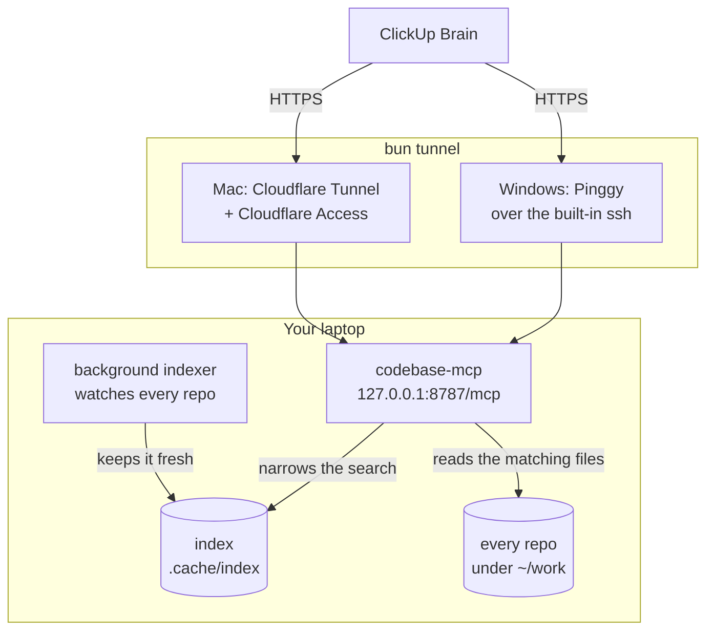

# codebase-mcp

**English** | [Bahasa Indonesia](README.id.md)

A read-only [MCP](https://modelcontextprotocol.io) server that lets **ClickUp Brain** (or Claude
Code, Cursor or any other MCP client) search, read and debug the code of **many repositories** on
your laptop. Answers are small and ranked, and every result is a `repo/path:line` you can open next.
It runs on a Mac and on a locked-down Windows work laptop.



**How it works, in plain words:**

1. **You ask ClickUp Brain**, for example "why does checkout fail with this error?". Brain calls
   codebase-mcp to look at the code.
2. **The call reaches your laptop through a tunnel** that `bun tunnel` opens: Cloudflare on a Mac,
   Pinggy on Windows. The server itself only listens on your own machine (`127.0.0.1`), and every
   call must carry your API key.
3. **codebase-mcp first asks the index which files can match**, then reads only those files and
   sends back the few lines that matter.
4. **The index works like the index at the back of a book.** It notes which short pieces of text
   appear in which file, plus the names of functions and classes, so a search across hundreds of
   repos opens a handful of files instead of all of them. It keeps no copy of your code. It lives in
   `.cache/index`, and you can delete it at any time; it is rebuilt.
5. **The background indexer keeps the index up to date on its own.** Every 30 seconds it checks each
   repo's git state, so a commit, a pull or a branch switch is picked up quickly. Every 10 minutes it
   also looks for files you edited but have not committed. Only changed files are indexed again.

Answers are always read from the files on disk, never from the index. If the index is a moment
behind, a search can miss a line you just wrote, but it never shows you an old one.

- **Built for debugging microservices.** Paste a stack trace, a log line or a failing URL and get
  the code behind it. Follow an HTTP route, a gRPC method or a Kafka topic to its handler and its
  callers in other services.
- **Fast across hundreds of repos.** A per-repo trigram index narrows every search to the files
  that can match. ripgrep then reads only those files. Measured: 200 repos (1.8 GB) answer a search
  in under 0.4 s.
- **Small answers.** Every answer has a token budget (6,000 by default) and steps down in detail
  instead of cutting off. A typical answer is 100–1,500 tokens; v1 sent up to 39,500 for one file.
- **Precise.** Ranking puts definitions first and tests, generated and vendored files last. Symbol
  definitions come from tree-sitter grammars in 15 languages.
- **Read-only by construction.** No tool writes, deletes or runs anything you choose. `.env` files
  and secrets are never listed, searched, read or shown in a diff. The one exception is opt-in:
  [switching a repo's branch](#switching-branches) from the chat.

## Contents

- [Tools](#tools)
- [How fast and how small](#how-fast-and-how-small)
- [Quick start](#quick-start)
- [Configuration](#configuration)
- [Connect it to ClickUp](#connect-it-to-clickup)
- [Mac secure setup: named tunnel + Cloudflare Access](#mac-secure-setup-named-tunnel--cloudflare-access)
- [Windows: Pinggy, and running without Bun](#windows-pinggy-and-running-without-bun)
- [Use it from Claude Code or Cursor (stdio)](#use-it-from-claude-code-or-cursor-stdio)
- [Supported languages and frameworks](#supported-languages-and-frameworks)
- [Security model](#security-model)
- [Commands](#commands)
- [Troubleshooting](#troubleshooting)
- [Development](#development)
- [Versioning](#versioning)

## Tools

Nine read-only tools, plus `switch_branch` when you turn it on (see
[switching branches](#switching-branches)). Answers are plain text. Every location is written as `repo/path:line`,
and `read_code` takes that same form, so a result can be opened straight away.

| Tool            | Use it to                                                                                                                                | Example input                                                           |
| --------------- | ---------------------------------------------------------------------------------------------------------------------------------------- | ----------------------------------------------------------------------- |
| `list_repos`    | See every service: languages, frameworks, endpoints, topics, last commit, index state. Filter by name, group or language.                | `{"query": "order"}`                                                    |
| `repo_overview` | Map one repo: build files, entrypoints, endpoints, topics and folders with file counts.                                                  | `{"repo": "orders", "path": "src/main"}`                                |
| `search_code`   | Search text in every repo at once, ranked and grouped by file, with the enclosing function. Modes: `literal` (default), `word`, `regex`. | `{"query": "Order already cancelled"}`                                  |
| `find_files`    | Find files by fuzzy name or path ("ordctl" finds `OrderController.java`).                                                                | `{"query": "order controller"}`                                         |
| `read_code`     | Read one function (`#Class.method`), a line (`:120`), a range (`:120-180`), a small file, or the outline of a large one.                 | `{"ref": "orders/src/…/OrderService.java#cancel"}`                      |
| `find_symbol`   | Jump to a definition by name (exact, then prefix, then substring), or list every reference.                                              | `{"name": "OrderService"}`                                              |
| `triage_error`  | Paste a stack trace, log line, error message or URL; get the code behind it.                                                             | `{"text": "java.lang.IllegalStateException: …"}`                        |
| `find_endpoint` | Follow a request: HTTP route to handler and callers, gRPC method to proto and implementation, topic to producers and consumers.          | `{"query": "POST /api/orders/42/cancel"}`                               |
| `git_history`   | Recent commits, when a string appeared (pickaxe), blame, and one commit's diff.                                                          | `{"repo": "orders", "action": "pickaxe", "query": "already cancelled"}` |
| `switch_branch` | Opt-in (`ALLOW_BRANCH_SWITCH`). List a repo's branches, or switch it to a local or already fetched one; never fetches.               | `{"repo": "orders", "branch": "develop"}`                               |

A debugging session in ClickUp Brain often looks like this:

```text
You:     Customers get "refund failed for payment p-77: refund payment p-77: payment already refunded". Why?
Brain →  triage_error {"text": "refund failed for payment p-77: refund payment p-77: payment already refunded"}
         #1 payments-go/internal/payment/handler.go:26 · in Refund   (the log call)
         #2 payments-go/internal/payment/service.go:9               (where the error is defined)
         #3 payments-go/internal/payment/service.go:21 · in Refund  (where it is wrapped)
Brain →  find_endpoint {"query": "POST /api/payments/77/refund"}
         Served by:  payments-go/main.go:16  POST /api/payments/:id/refund  (gin, handler)
         Called by:  orders-java/…/PaymentClient.java:9  POST /api/payments/{id}/refund  (feign, caller)
Brain →  git_history {"repo": "payments-go", "action": "pickaxe", "query": "payment already refunded"}
```

What each tool returns, with every argument: [docs/tools.md](docs/tools.md).

## How fast and how small

Measured on a MacBook (Apple silicon) with Bun 1.3.12. The full tables and how to reproduce them
are in [docs/benchmarks.md](docs/benchmarks.md).

| Corpus                      | Source | Index  | Index build | `search_code` p95 | `find_symbol` p95 | Tokens per answer |
| --------------------------- | ------ | ------ | ----------- | ----------------- | ----------------- | ----------------- |
| 4 public microservice repos | 36 MB  | 8 MB   | 1.1 s       | 34 ms             | 1 ms              | 80–1,500          |
| The same, ×50 (200 repos)   | 1.8 GB | 379 MB | 33 s        | 372 ms            | 56 ms             | 300–2,400         |

The eval runs 20 debugging tasks through the real tools: 100% find the right place within the
expected rank, 85% at rank 1, and an answer averages 131 tokens. For comparison, v1 took 4.4 s per
search over 27,000 files, and one `read_file` cost about 39,500 tokens.

## Quick start

### 1. Prerequisites

|         | Mac                                                           | Windows                                                                                                         |
| ------- | ------------------------------------------------------------- | --------------------------------------------------------------------------------------------------------------- |
| Runtime | [Bun](https://bun.sh) 1.3.12+: `brew install oven-sh/bun/bun` | Bun (`powershell -c "irm bun.sh/install.ps1 \| iex"`), or **Node.js 22.18+** where installing Bun isn't allowed |
| Tunnel  | `brew install cloudflared`                                    | The `ssh` that ships with Windows 10/11 (_Settings → System → Optional features → OpenSSH Client_)              |
| git     | Comes with Xcode tools                                        | Git for Windows                                                                                                 |

ripgrep, SQLite and the tree-sitter grammars come with `bun install`. There is nothing to compile.

### 2. Install and set up

```bash
cd codebase-mcp
bun install
bun run setup            # asks for the folder that holds your repos, e.g. ~/work
```

`setup` finds every git repository below that folder and writes `codebase.config.json`. It also
creates `.env` with a strong `MCP_API_KEY`. The key is never printed: open `.env` when you need to
paste it into ClickUp. To run setup without prompts:

```bash
bun run setup --root ~/work --root D:/code --yes
```

**Prefer a fixed list of repos?** Put it in `REPOS` in `.env`, as `name=path;name=path`. While
`REPOS` is set, it decides exactly which repos are served, and the `roots` and `repos` of
`codebase.config.json` are skipped. `setup` then shows the list and adds the repos you name to it,
instead of asking for a folder. Each one must be a git repository, and a folder already listed is
not added twice. Restart `bun start` after a change.

```bash
bun run setup --repo ~/work/orders-api --repo web=D:/code/web-app
```

### 3. Run

```bash
# Terminal 1: the server, reachable only from this laptop. It indexes in the background.
bun start

# Terminal 2: open the tunnel only while ClickUp needs access. Ctrl+C closes it.
bun tunnel
```

- The server answers from the first second. Until a repo's index is ready, its searches read the
  files directly, so they are slower but still complete.
- `bun tunnel` picks Cloudflare on a Mac and Pinggy on Windows. Set `TUNNEL=cloudflared` or
  `TUNNEL=pinggy` in `.env` to choose. It refuses to start while the server is down.
- **Your MCP URL is the tunnel URL plus `/mcp`.**

Then check everything:

```bash
bun run doctor                          # runtime, key, config, repos, ripgrep, git, SQLite, grammars, server, tunnel
bun run check https://<your-tunnel-url> # calls the public URL the way ClickUp will
```

Or start both in one go: `./start-mac.sh` on a Mac, or `start-windows.bat` on Windows. Both run
setup first when there is no configuration yet.

## Configuration

Two files, both machine-local and gitignored:

- **`codebase.config.json`**: which repos to serve (unless `REPOS` in `.env` is set), plus
  limits. `bun run setup` writes it.
  [`codebase.config.example.json`](codebase.config.example.json) shows every field, and
  `codebase.config.schema.json` gives your editor completion.
- **`.env`**: secrets, machine settings, and `REPOS` when you list your repos there. See
  [`.env.example`](.env.example).

```json
{
  "$schema": "./codebase.config.schema.json",
  "roots": [{ "path": "~/work", "maxDepth": 3, "exclude": ["archive/**"] }],
  "repos": [{ "name": "legacy-billing", "path": "D:/code/legacy-billing", "group": "payments" }],
  "exclude": ["**/*.min.js"],
  "blocked": ["\\.sql$"],
  "logging": { "loggerNames": ["AuditLog"] },
  "limits": {
    "maxResponseTokens": 6000,
    "maxFileBytes": 1048576,
    "searchTimeoutMs": 20000,
    "maxReadLines": 200
  },
  "index": { "enabled": true, "dir": ".cache/index", "refreshSeconds": 30, "rescanMinutes": 10 }
}
```

The file is plain JSON: the server reads it with `JSON.parse`, so comments and trailing commas make
it refuse to start. Every field is optional, but without `roots` or `repos` there is nothing to
serve.

| Field                        | Meaning                                                                                                                                                                                   |
| ---------------------------- | ----------------------------------------------------------------------------------------------------------------------------------------------------------------------------------------- |
| `roots`                      | Folders whose git repos are all served, up to `maxDepth` levels down (default 3), minus `exclude` globs. The first folder below the root becomes the group, unless the root sets `group`. |
| `repos`                      | Single repos anywhere else, each with a `name`, a `path` and an optional `group`.                                                                                                         |
| `exclude`                    | Globs of files that are never searched or indexed, on top of `.gitignore`.                                                                                                                |
| `blocked`                    | Extra regexes for file or folder names that must never be read, on top of the built-in secret list.                                                                                       |
| `logging.loggerNames`        | In-house logger names, so `triage_error` recognises their calls as log statements.                                                                                                        |
| `limits.maxResponseTokens`   | Upper bound for one tool answer, in tokens (default 6000).                                                                                                                                |
| `limits.maxFileBytes`        | Larger files are listed but never read, searched or indexed (default 1 MiB).                                                                                                              |
| `limits.searchTimeoutMs`     | A search stops after this long and returns what it found (default 20000).                                                                                                                 |
| `limits.maxReadLines`        | Most lines `read_code` returns in one call (default 200).                                                                                                                                 |
| `index.enabled`, `index.dir` | The background index (on by default) and where its shards live (default `.cache/index`).                                                                                                  |
| `index.refreshSeconds`       | How often each repo's `HEAD` and git index are checked for changes (default 30).                                                                                                          |
| `index.rescanMinutes`        | How often every file is re-checked for edits git has not seen yet (default 10).                                                                                                           |

| `.env` variable                                                | Default                  | Meaning                                                                                                                                         |
| -------------------------------------------------------------- | ------------------------ | ----------------------------------------------------------------------------------------------------------------------------------------------- |
| `MCP_API_KEY`                                                  | none                     | Required, at least 24 characters. `bun run setup` creates it; `bun run gen-key` prints a new one.                                               |
| `PORT`, `HOST`                                                 | `8787`, `127.0.0.1`      | Where the server listens. The tunnel is the only way in.                                                                                        |
| `CODEBASE_CONFIG`                                              | `./codebase.config.json` | Another config file.                                                                                                                            |
| `REPOS`                                                        | none                     | `name=path;name=path`. When set, exactly these repos are served (the config's `roots`/`repos` are skipped). Restart `bun start` after a change. |
| `EXTRA_BLOCKED`                                                | none                     | Extra regexes for file names that must never be read, comma-separated.                                                                          |
| `ALLOW_BRANCH_SWITCH`                                          | off                      | `1` (every repo) or repo names, comma-separated: adds `switch_branch`. See [switching branches](#switching-branches). |
| `RG_PATH`, `CODEBASE_NO_RIPGREP`                               | bundled ripgrep          | Another ripgrep binary, or `1` to force the JavaScript scanner.                                                                                 |
| `LOG_LEVEL`                                                    | `info`                   | `debug`, `info`, `warn` or `error`. See [Reading the logs](#reading-the-logs).                                                                  |
| `TUNNEL`, `CF_TUNNEL_TOKEN`, `PINGGY_TOKEN`                    | per platform             | Tunnel settings for `bun tunnel`.                                                                                                               |
| `PUBLIC_URL`, `CF_ACCESS_CLIENT_ID`, `CF_ACCESS_CLIENT_SECRET` | none                     | Used by `bun run check` only.                                                                                                                   |

**The index** lives in `.cache/index/`, one SQLite file per repo, about a fifth of the size of the
source. You can delete it at any time; it is rebuilt. Every 30 seconds the server checks each repo's
`HEAD` and git index with a few `stat` calls, and re-indexes only the files that changed. A full
rescan for edits git hasn't seen runs every 10 minutes. Search results are always read from the
files on disk, so a stale index can only miss a hit, never show a wrong line.

## Connect it to ClickUp

Run `bun run check` first. If it passes, ClickUp will work with the same URL, key and headers.

Open ClickUp in a **browser** (not the desktop app) → **Settings → App Center → MCP Servers** → add
a new server. The _Connect an MCP Server_ form opens. Fill it in like this:

| Field                               | What to enter                                                                                                                                              |
| ----------------------------------- | ---------------------------------------------------------------------------------------------------------------------------------------------------------- |
| **Name**                            | A name you'll recognize, e.g. `Work Codebase MCP`                                                                                                          |
| **URL**                             | Your tunnel URL + `/mcp`, e.g. `https://work-codebase-mcp.yourdomain.com/mcp`. Use `/mcp`, not `/sse`.                                                     |
| **Description**                     | `Read-only access to my local repositories: search code, read functions, triage stack traces and logs, follow endpoints across services, and git history.` |
| **Authentication Method**           | `Authorization header`                                                                                                                                     |
| **Authorization Header**, left box  | `Authorization` (keep the default)                                                                                                                         |
| **Authorization Header**, right box | `Bearer ` followed by the value of `MCP_API_KEY` in `.env`, e.g. `Bearer 3f9a…c21d`. Keep the space after `Bearer` and don't add one at the end.           |

**Custom Headers** depend on the tunnel. Use **Add header** for each row, and delete rows you don't
need with the trash icon:

| Tunnel                           | Header name               | Header value                                     |
| -------------------------------- | ------------------------- | ------------------------------------------------ |
| Cloudflare named tunnel + Access | `CF-Access-Client-Id`     | the value of `CF_ACCESS_CLIENT_ID` in `.env`     |
|                                  | `CF-Access-Client-Secret` | the value of `CF_ACCESS_CLIENT_SECRET` in `.env` |
| Cloudflare quick tunnel          | none                      |                                                  |
| Pinggy free tunnel               | `X-Pinggy-No-Screen`      | `1` (stops Pinggy's browser screening page)      |

Click **Next**. ClickUp connects and lists the 9 tools. Then try it in ClickUp Brain: _"Use the
codebase MCP. Here is a stack trace from production: … Which code throws it, and what changed
there recently?"_

If **Next** fails:

| What you see                                                    | Likely cause                                                                                                                                | Fix                                                                                                                                                                           |
| --------------------------------------------------------------- | ------------------------------------------------------------------------------------------------------------------------------------------- | ----------------------------------------------------------------------------------------------------------------------------------------------------------------------------- |
| Can't connect, or a timeout                                     | The server or the tunnel isn't running                                                                                                      | Start `bun start` and `bun tunnel`, then `bun run check`                                                                                                                      |
| `401 Unauthorized`                                              | The API key doesn't match                                                                                                                   | Check the `Bearer ` prefix, and that the key equals `MCP_API_KEY` with no extra spaces                                                                                        |
| `403`, or a Cloudflare login page                               | The Access headers are missing or wrong                                                                                                     | Check both `CF-Access-Client-*` headers and their values                                                                                                                      |
| `405` or `404`                                                  | The URL doesn't end in `/mcp`                                                                                                               | Add `/mcp` to the URL                                                                                                                                                         |
| "Connected to the server, but couldn't validate the connection" | ClickUp reached the URL but the MCP handshake failed                                                                                        | Restart `bun start`, click **Next** again, and read the status code in the server log (see below)                                                                             |
| Same message, and **nothing** appears in the server log         | Cloudflare **Bot Fight Mode** challenges ClickUp's servers. The domain's _Security → Events_ shows _Managed Challenge_ by _Bot fight mode_. | Turn off Bot Fight Mode for the domain (_Security → Settings_). On the Free plan it can't be skipped for one hostname. Access and the API key still protect the MCP hostname. |
| `bun run check` passes, but ClickUp fails                       | A typo in the form                                                                                                                          | Compare each field with `.env` again                                                                                                                                          |

Every request shows up in the server's terminal with what ClickUp asked for and the result, e.g.
`POST /mcp 200 rpc=tools/call tool=search_code ms=84`, or `rpc=initialize protocol=… client=…` on
connect. If nothing appears when you click **Next**, the request never reached your laptop: check
the tunnel and the Cloudflare Access headers.

## Mac secure setup: named tunnel + Cloudflare Access

This gives you a **fixed URL** (e.g. `https://work-codebase-mcp.yourdomain.com`) and a second lock
in front of your laptop: Cloudflare rejects any request without your service token, so it never
reaches the server. The API key check still applies on top.

You need a free Cloudflare account and a domain whose DNS is managed by Cloudflare. **Bot Fight
Mode must be off on that domain** (_Security → Settings_): it challenges ClickUp's servers, which
can't solve a browser challenge, and on the Free plan it can't be turned off for one hostname. If
other sites on the domain need it, use a separate domain for the tunnel. Menu names in the Zero
Trust dashboard sometimes change; the steps describe what to look for.

1. **Create the tunnel.** In the [Zero Trust dashboard](https://one.dash.cloudflare.com) →
   _Networks → Tunnels_ → _Create a tunnel_ → type **Cloudflared** → name it
   `work-codebase-mcp`. On the install step, copy the long token after `--token`. You don't need
   to run the install command.
2. **Route a hostname to your server.** In the tunnel's _Public Hostname_ (or _Published
   application routes_) tab, add subdomain `work-codebase-mcp`, domain `yourdomain.com`, service
   type **HTTP**, URL `127.0.0.1:8787`.
3. **Create a service token.** _Access → Service Auth → Service Tokens_ → _Create Service Token_.
   Copy the **Client ID** and **Client Secret**. The secret is shown only once.
4. **Protect the hostname with Access.** _Access → Applications_ → _Add an application_ →
   **Self-hosted** → domain `work-codebase-mcp.yourdomain.com`. Add a policy with action **Service
   Auth** that includes the service token from step 3.
5. **Put the values in `.env`:**

   ```env
   CF_TUNNEL_TOKEN=<token from step 1>
   PUBLIC_URL=https://work-codebase-mcp.yourdomain.com
   CF_ACCESS_CLIENT_ID=<client id from step 3>
   CF_ACCESS_CLIENT_SECRET=<client secret from step 3>
   ```

   Only `CF_TUNNEL_TOKEN` is used to run the tunnel. It is passed to cloudflared through its
   environment, never on the command line, so it doesn't show up in process lists or logs. The
   other three are for `bun run check`; the server never reads them.

6. **Test it:** `bun run check`. With the service token set, it also confirms that Cloudflare
   blocks requests without the token.
7. **In ClickUp**, use the URL `https://work-codebase-mcp.yourdomain.com/mcp`, the
   `Authorization: Bearer <API key>` header, and the two custom headers `CF-Access-Client-Id` and
   `CF-Access-Client-Secret` with the values from `.env`.

## Windows: Pinggy, and running without Bun

**Pinggy** runs over the `ssh` client that ships with Windows, for machines where installing
software isn't allowed. The first time, ssh may ask you to trust the Pinggy host: type `yes`. If it
asks for a password, just press Enter. Pinggy then shows a URL like
`https://abcd-12-34-56-78.run.pinggy-free.link`.

A free Pinggy tunnel gets a **random URL** and is **time-limited**. When it closes, `bun tunnel`
asks you to press Enter to reconnect; the new URL has to be updated in ClickUp. For a fixed URL with
no time limit, use **Pinggy Pro**: put your access token in `.env` as `PINGGY_TOKEN`.

**Without Bun.** Node.js 22.18 and newer run TypeScript directly, so the same code runs on a laptop
where only Node is allowed. `start-windows.bat` switches to Node by itself when Bun isn't found. By
hand:

```powershell
npm install --omit=dev --ignore-scripts
node --disable-warning=ExperimentalWarning scripts/setup/setup.ts
node --disable-warning=ExperimentalWarning src/index.ts start
node --disable-warning=ExperimentalWarning scripts/tunnel/tunnel.ts
```

`--ignore-scripts` means nothing is downloaded or built during the install. If the laptop blocks
the bundled `rg.exe`, search falls back to a JavaScript scanner; `bun run doctor` (or
`node … scripts/doctor/doctor.ts`) tells you which engine is in use.

## Use it from Claude Code or Cursor (stdio)

The same server speaks MCP over stdin and stdout, without HTTP, a key or a tunnel:

```bash
claude mcp add codebase -- bun /path/to/codebase-mcp/src/index.ts stdio
```

For Cursor or another client, the command is `bun` with the arguments
`["/path/to/codebase-mcp/src/index.ts", "stdio"]`.

## Supported languages and frameworks

| Tier                 | Languages                                               | What you get                                                                                                   |
| -------------------- | ------------------------------------------------------- | -------------------------------------------------------------------------------------------------------------- |
| 1                    | Java, Kotlin, Go, TypeScript and JavaScript, Python, C# | tree-sitter symbols, stack traces, log statements, and HTTP, gRPC and topic extraction for the main frameworks |
| 2                    | PHP, Ruby, Rust, Scala, C, C++, Elixir                  | tree-sitter symbols, plus stack traces and routes for PHP, Ruby and Elixir                                     |
| 3                    | Swift, Dart, and any other text file                    | search, plus symbols from line patterns                                                                        |
| Contracts and config | `.proto`, YAML, JSON, SQL, Dockerfile, Makefile, …      | search; gRPC services from `.proto`; SQL tables                                                                |

| Kind          | Frameworks found                                                                                                                                                                                                            |
| ------------- | --------------------------------------------------------------------------------------------------------------------------------------------------------------------------------------------------------------------------- |
| HTTP handlers | Spring MVC and WebFlux, JAX-RS, Ktor, gin, echo, chi, gorilla/mux, net/http, ASP.NET (controllers and minimal APIs), Express, Koa, Fastify, Hono, NestJS, FastAPI, Flask, Django, Laravel, Symfony, Rails, Sinatra, Phoenix |
| HTTP callers  | Feign, RestTemplate, WebClient, Retrofit, Go `net/http`, `HttpClient`/Refit, axios, fetch, got, requests, httpx, aiohttp                                                                                                    |
| Messaging     | Kafka (Spring, kafka-go, sarama, confluent, kafkajs, kafka-python, aiokafka), RabbitMQ, MassTransit                                                                                                                         |
| gRPC          | `.proto` services and methods, with their implementations and stubs                                                                                                                                                         |

<a id="switching-branches"></a>

**Switching branches from the chat** is off by default. Set `ALLOW_BRANCH_SWITCH=1` in `.env`
(or a comma-separated list of repo names, such as `ALLOW_BRANCH_SWITCH=orders,payments`) and
restart `bun start`. ClickUp Brain then gets a tenth tool, `switch_branch`: _"switch orders to
develop"_ checks out that branch, and every other tool reads it from then on. The switch changes the
folder on disk, so it suits a machine that only serves this MCP.

- **Only what is already on this machine.** A local branch, or a remote branch you have already
  fetched (a fresh clone has them all as `origin/…`): switching to one of those creates its local
  branch from the copy on disk, and the answer says how fresh that copy is. Nothing is downloaded,
  so for newer commits, or a branch that was never fetched, run `git fetch` yourself.
- **No network, no hooks.** Git may not reach any remote during the switch (`protocol.allow=never`,
  which also stops a partial clone from downloading objects), repo hooks don't run, and submodules
  and Git LFS downloads are skipped (LFS files stay pointers).
- **Nothing is lost.** A repo with uncommitted changes is refused, and there is no force.
- **Visible.** Every switch is logged (`branch switched`), the banner says
  `Branch switching: on for …`, and the index catches up with the changed files in the background.

A language is a folder under `src/languages/`. Adding one takes no change to the core; see
[CONTRIBUTING.md](CONTRIBUTING.md).

## Security model

- **Read-only.** No tool writes, deletes or runs anything a caller chooses. The only programs
  started are `git`, with fixed read-only subcommands, and ripgrep. The one exception is opt-in:
  with `ALLOW_BRANCH_SWITCH` set, `switch_branch` runs one fixed `git switch` to an existing local
  branch, with no network, no hooks and no force. Both get an argument array,
  never a shell, and an environment with no secrets.
- **Paths are jailed.** Absolute paths, `../` and symlinks that leave the repo are refused, both
  before and after the real path is resolved. `.git/` can't be read.
- **Secrets stay hidden.** These are never listed, indexed, searched, read or shown in a diff:
  - every `.env` variant (`.env`, `.env.local`, `.env.example`, `prod.env`, `.envrc`, `.env.`,
    `.env::$DATA`);
  - keys and certificates (`*.pem`, `*.key`, `*.jks`, `id_rsa`, …);
  - `.npmrc`;
  - names with `secret` or `credentials`;
  - `application-prod.yml`;
  - anything you add in `blocked` or `EXTRA_BLOCKED`.

  On top of that, every answer is scrubbed of token-like values (API keys, JWTs, private keys,
  `password=…`, credentials in URLs) before it leaves.

- **Hardened git** (after the CVEs in the reference git MCP server):
  - Revisions and dates are validated, and `--end-of-options` and `--literal-pathspecs` are used.
  - System and global git config are ignored, along with fsmonitor, the pager, prompts, external
    diff and textconv.
- **Auth before tools.** `/mcp` checks, in this order, the body size (1 MB), a rate limit (120
  requests a minute per client) and the API key, which is compared in constant time.
- **Local only.** The server listens on `127.0.0.1`; the tunnel is the only way in. Close the
  tunnel and ClickUp's access ends immediately.

> Your code passes through the tunnel provider (Cloudflare or Pinggy) on its way to ClickUp. If this
> is a company laptop or company code, check with your IT or security team first.

Reporting a vulnerability: [SECURITY.md](SECURITY.md).

## Commands

| Command                                      | What it does                                                                         |
| -------------------------------------------- | ------------------------------------------------------------------------------------ |
| `bun run setup`                              | Create the API key, then add repos to `REPOS`, or find repos under a folder          |
| `bun start`                                  | Start the HTTP server and the background indexer                                     |
| `bun tunnel`                                 | Open the tunnel (Cloudflare on Mac, Pinggy on Windows)                               |
| `bun run check [url]`                        | Call the public URL the way ClickUp will                                             |
| `bun run doctor`                             | Check runtime, key, config, repos, ripgrep, git, SQLite, grammars, server and tunnel |
| `bun run index`                              | Build or refresh every repo's index, then exit                                       |
| `bun run stdio`                              | Serve MCP over stdin and stdout, for local clients                                   |
| `bun run gen-key`                            | Print a new random API key                                                           |
| `bun run eval`                               | Run the debugging scenarios and report hit rate, tokens and latency                  |
| `bun run bench -- --corpus <dir> --copies N` | Scale benchmark: index and query N copies of the repos in `<dir>`                    |

## Troubleshooting

| Symptom                                                | Fix                                                                                                                                                              |
| ------------------------------------------------------ | ---------------------------------------------------------------------------------------------------------------------------------------------------------------- |
| `MCP_API_KEY is missing or shorter than 24 characters` | Run `bun run setup`, or put the output of `bun run gen-key` in `.env`                                                                                            |
| `No repos configured`                                  | Run `bun run setup`, or check `roots` in `codebase.config.json`. `bun run doctor` lists what was found.                                                          |
| A repo shows `not indexed` or `indexing 40%`           | It is still being indexed. Searches already work, only slower. `bun run index` builds everything in one go.                                                      |
| Results look outdated                                  | Commit or save the file; the server picks up changes within 30 seconds, or 10 minutes for edits git hasn't seen. Deleting `.cache/index/` rebuilds from scratch. |
| `Search: JavaScript scanner` in the start banner       | ripgrep can't run on this machine. Search still works, slower. `bun run doctor` explains why.                                                                    |
| `Grammars: missing` in doctor                          | Run `bun run grammars:sync`                                                                                                                                      |
| Windows: `'node' is not recognized` or a syntax error  | Install Node.js 22.18 or newer, or Bun                                                                                                                           |

### Reading the logs

The server writes one line per event to the terminal that runs `bun start`:
`[time] LEVEL message key=value …`. Logs stay on your machine; nothing is sent anywhere.
`LOG_LEVEL` in `.env` sets how much you see, and takes effect when the server restarts:

- `info` (default): every request, every tool call (time, size in tokens), and every index run that
  changed files.
- `debug`: also one **search plan** line per search and the **reason** for every index run, including
  runs that found nothing to do. Use it while you investigate a slow or surprising search, then go
  back to `info`.
- `warn` or `error`: problems only, such as a grammar that failed to load or a tool that crashed.

For a single run, set it in front of the command: `LOG_LEVEL=debug bun start` on Mac, or
`$env:LOG_LEVEL='debug'; bun start` in PowerShell. To see only the search plans, filter the output:
`bun start 2>&1 | grep "search plan"` (PowerShell: `bun start 2>&1 | Select-String "search plan"`).
An example, for illustration:

```text
[2026-10-14T09:12:03.120Z] INFO indexed repo=orders-java reason=startup files=10 changed=10 removed=0 ms=51
[2026-10-14T09:15:33.004Z] DEBUG git state changed repo=orders-java changed="branch ref, git index"
[2026-10-14T09:15:33.161Z] INFO indexed repo=orders-java reason="git: branch ref, git index" files=11 changed=2 removed=0 ms=14
[2026-10-14T09:22:03.410Z] DEBUG index unchanged repo=payments-go reason=rescan files=5 changed=0 removed=0 ms=3
[2026-10-14T09:23:41.877Z] DEBUG search plan pattern="Order already cancelled" mode=literal route="index: more than 3 repos" repos=6 indexRepos=1 candidateFiles=1 ruledOut=5 scannedRepos=0 engines=index filesSearched=1 matches=1 timedOut=false planMs=1 ms=9
```

**A search plan** says how a search ran and where its time went:

| Field                          | Meaning                                                                                                                                                                                   |
| ------------------------------ | ----------------------------------------------------------------------------------------------------------------------------------------------------------------------------------------- |
| `route`                        | Why the index was or was not used: `index: more than 3 repos`, `index: ripgrep unavailable`, `scan: 3 repos or fewer` (ripgrep is as fast there), or `scan: no literal of 3+ characters`. |
| `indexRepos`, `candidateFiles` | Repos answered through the index, and how many files the index left to read in them.                                                                                                      |
| `ruledOut`                     | Repos the index excluded outright: no file in them can match.                                                                                                                             |
| `scannedRepos`                 | Repos read in full: not indexed yet, still indexing, or more than 5,000 candidate files.                                                                                                  |
| `engines`                      | What did the reading: `index`, `ripgrep`, or `scan` (the JavaScript scanner).                                                                                                             |
| `filesSearched`, `matches`     | Files actually read, and lines that matched.                                                                                                                                              |
| `timedOut`                     | `true` when the search hit `limits.searchTimeoutMs` and returned what it had.                                                                                                             |
| `planMs`, `ms`                 | Time spent asking the index, and the whole search.                                                                                                                                        |

When a search is slow:

- **A high `scannedRepos` on the index route.** Those repos are not indexed yet (`list_repos` shows
  their state), or the text is too common. A more specific query fixes the second case.
- **`route="scan: no literal of 3+ characters"`.** The regex has no word of three or more characters
  the index can use. Add one, for example `findOrder\w+Id` instead of `(get|find)\w+Id`.
- **`timedOut=true`.** Narrow the search with `repos`, `group` or `path`.
- **`engines=scan`.** ripgrep cannot run on this machine. `bun run doctor` says why.

**An index line** names its reason:

- `startup`: the first run after the server started.
- `rescan`: the periodic check of every file, every `index.rescanMinutes`.
- `git: <parts>`: the repo's git state changed. `HEAD` means a checkout, `branch ref` a commit or a
  pull, `git index` staging or a checkout, and `packed refs` a fetch or `git gc`.
- `requested`: the server queued it directly.

A run with `changed=0` costs little and is logged at `debug` only. If one repo is re-indexed every
30 seconds although nobody works in it, a tool is touching its git index; an editor that keeps
running `git status` can do this.

## Development

```sh
codebase-mcp/
├── src/
│   ├── index.ts         # CLI entry: start (HTTP), stdio, index
│   ├── app.ts           # the Hono app: middleware order, /health, /mcp
│   ├── env.ts           # the only reader of environment variables
│   ├── core/            # pure logic: ranking, budgets, query planning, stack and log parsing,
│   │                    # route matching, security
│   ├── ports/           # interfaces the engine depends on
│   ├── adapters/        # I/O: file system, ripgrep, SQLite index, tree-sitter, git, runtime (Bun or Node)
│   ├── languages/       # one folder per language: extensions, grammar, symbol patterns, routes,
│   │                    # stack parser
│   ├── config/          # codebase.config.json schema, loading, repo discovery, the repo registry
│   ├── indexer/         # the background indexer: inventory, per-repo shards, worker threads, freshness
│   ├── engine/          # application services: search planner, symbols, catalog, stack traces,
│   │                    # log sources, endpoints
│   ├── tools/           # the nine MCP tools: <name>.tool.ts → <domain>.service.ts → <domain>.format.ts
│   ├── http/            # Hono middlewares and the MCP transport
│   ├── composition/     # wires adapters into the runtime (the composition root)
│   ├── cli/             # the start banner
│   └── testing/         # shared test helpers: temporary workspaces, a full test runtime
├── assets/
│   ├── grammars/        # tree-sitter WASM grammars, pinned
│   └── queries/         # symbol queries per grammar
├── scripts/             # setup, tunnel, doctor, remote check, keys, eval, bench, grammars, CI, quality gates
└── tests/
    └── fixtures/repos/  # six mini services (Java, Go, Node, Python, .NET, proto) for tests and the eval
```

The architecture, the request flow and the reasons behind them are in
[docs/architecture.md](docs/architecture.md). The rules an assistant follows in this repo are in
[AGENTS.md](AGENTS.md).

Quality gates run on every commit (husky) and every pull request (CI on macOS, Windows and Ubuntu):

```bash
bun run fl                 # format (oxfmt) + lint (oxlint, type-aware)
bun run type-check         # TypeScript 7, strict
bun run test:coverage      # 600+ tests, 100% of lines and functions per file
bash scripts/check/gates.sh  # everything above plus comment style, dead code, folder shape, secrets, …
```

- Files are at most 200 lines and functions at most 40.
- Comments use `/** */` or `/* */`, never `//`.
- There is no `any`, and layers import in one direction only, which lint enforces.

See [CONTRIBUTING.md](CONTRIBUTING.md).

## Versioning

[Semantic Versioning](https://semver.org). The version in `package.json` is the one the server
reports to clients. Changes are listed in [CHANGELOG.md](CHANGELOG.md), and releases are tagged
`vX.Y.Z` with a GitHub Release; the process is in [RELEASING.md](RELEASING.md).

## Tips

- The laptop must be on, awake and running the tunnel. On a Mac, `bun tunnel` keeps it awake with
  `caffeinate` while the tunnel is open. On Windows, set Power Options so it doesn't sleep while
  plugged in.
- Run `git pull` in your repos regularly so the assistant reads the latest code. The index follows
  by itself.
- If the API key was ever shared, rotate it (put a new `bun run gen-key` in `.env`), then update
  ClickUp. Do the same for the Cloudflare service token.
